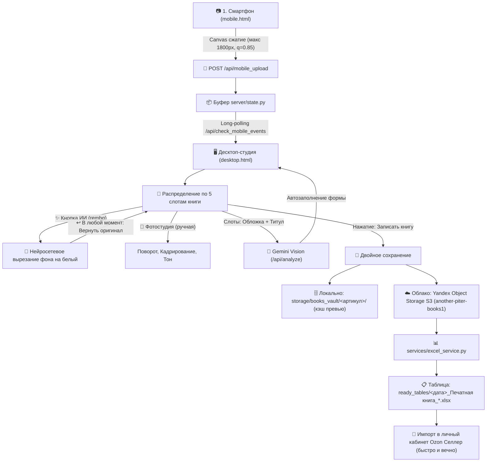

# 📸 Регламент и алгоритм обработки фотографий (Bookinistic Photo Pipeline)

> **Назначение документа**: Этот файл является официальным техническим описанием и эталоном алгоритма обработки фотографий в проекте Bookinistic Studio. При любых изменениях логики работы с изображениями (съёмка, фильтры, слоты, сохранение, выгрузка на Ozon) данный документ должен актуализироваться.

---

## 🗺️ Общая схема конвейера (End-to-End)

---

## 📋 Этапы и технические правила

### Этап 1. Захват и клиентская оптимизация на смартфоне
- **Файл**: [templates/mobile.html](file:///Users/igor/Projects/real_projects/bookinistic/templates/mobile.html)
- **Маршрут**: `/mobile` (доступ через QR-код, локальный IP или Cloudflare Tunnel).
- **Правило сжатия**:
  - Исходные тяжёлые фотографии (8–15 МБ) масштабируются прямо на смартфоне в элементе `<canvas>` до максимальной стороны в **1800 px** с качеством JPEG **0.85**.
  - На сервер передаются легковесные base64-изображения (~250–350 КБ), что обеспечивает мгновенную загрузку даже при слабом мобильном интернете.

---

### Этап 2. Приём на сервере и распределение по слотам
- **Файлы**: [server/state.py](file:///Users/igor/Projects/real_projects/bookinistic/server/state.py), [server/handler.py](file:///Users/igor/Projects/real_projects/bookinistic/server/handler.py)
- Десктопная студия опрашивает `/api/check_mobile_events` каждые 1.5 секунды.
- При появлении новой пачки десктоп воспроизводит звуковой сигнал и добавляет фото в пул.
- **5 категорий слотов книги**:
  1. `cover_front` — **Лицевая обложка** (строго 1 фото, главное лицо карточки).
  2. `cover_back` — **Задняя сторона обложки** (выходные данные, цена СССР, штрихкод).
  3. `info_pages` — **Титульный лист и оборот** (для распознавания ИИ и архива).
  4. `illustrations` — **Иллюстрации и развороты** (гравюры, цветные вклейки, качество печати).
  5. `mantra_defects` — **Дефекты и колофон** (потёртости, надрывы, лисьи пятна, тираж).

---

### Этап 3. Фотолаборатория и предпечатная подготовка (In-Browser Studio)
- **Файлы**: [services/image_service.py](file:///Users/igor/Projects/real_projects/bookinistic/services/image_service.py), [templates/desktop.html](file:///Users/igor/Projects/real_projects/bookinistic/templates/desktop.html)
- **ИИ-вырезание фона (`rembg` / `u2net`)**:
  - Автономная локальная нейросеть аккуратно отделяет книгу от любого стола и сажает на чистый белый `#FFFFFF` с легким Unsharp Mask.
  - Работает в фоновом `ThreadPoolExecutor(max_workers=2)` без блокировки интерфейса и без перегрева процессора Mac.
- **100% обратимость (Undo / Revert)**:
  - Исходный кадр всегда хранится в `cameraOriginal`/`rawOriginal`. Кнопка `↩️` в любой момент возвращает сырой снимок.
  - В студии кнопка `👁️ Зажать: Оригинал` позволяет мгновенно оценить результат «До / После».
- **Ручные инструменты**:
  - Точный поворот на 90°, кадрирование с пропорциями (3:4 Ozon, 1:1, свободная обрезка полей), тонкая настройка яркости и контраста.

---

### Этап 4. Передача в нейросеть Gemini Vision
- **Файл**: [services/ai_service.py](file:///Users/igor/Projects/real_projects/bookinistic/services/ai_service.py)
- Для экономии токенов и ускорения анализа нейросеть получает только 2 ключевых ракурса:
  - Лицевую обложку (`cover_front`);
  - Титульный лист (`info_pages[0]`).
- Нейросеть считывает метаданные, генерирует аннотацию и подбирает жанр из утверждённого справочника [core/constants.py](file:///Users/igor/Projects/real_projects/bookinistic/core/constants.py).
- **Правило фильтрации**: Хештеги (`#...`) строго вычищаются и блокируются при записи.

---

### Этап 5. Локальный архив (Vault) и именование файлов
- **Файл**: [services/vault_service.py](file:///Users/igor/Projects/real_projects/bookinistic/services/vault_service.py)
- При нажатии «Записать книгу в Excel» создаётся директория:
  `storage/books_vault/<артикул>_<чистое_название>/`
- **Строгий стандарт именования**:
  | Слот книги | Имя файла в архиве | Алиас Ozon | Идёт на Ozon? |
  | :--- | :--- | :--- | :---: |
  | Лицевая обложка | `01_cover_front.jpg` | `<артикул>.jpg` | **Да (Главное фото)** |
  | Задняя обложка | `02_cover_back.jpg` | `<артикул>_1.jpg` | **Да (Доп. фото 1)** |
  | Титульный лист / инфо | `03_info_page_<N>.jpg` | — | ❌ **НЕТ (Архив)** |
  | Иллюстрации | `04_illustration_<N>.jpg` | `<артикул>_<N+1>.jpg` | **Да (Доп. фото)** |
  | Дефекты книги | `05_defect_<N>.jpg` | `<артикул>_<N+K>.jpg` | **Да (Доп. фото)** |
  | Фирменная карточка | `99_card.jpg` | `<артикул>_card.jpg` | **Да (Финальное доп. фото)** |

> [!CRITICAL]
> **ПРАВИЛО ТИТУЛЬНЫХ ЛИСТОВ**:
> Фотографии титульных листов и оборота (`03_info_page`) сохраняются в локальном архиве и облачном `archive/`, но **никогда не включаются в ссылки таблицы Ozon**. На витрине маркетплейса покупателю нужны только обложки, реальные иллюстрации и честные фото дефектов.

---

### Этап 6. Выгрузка в Yandex S3 и запись в Excel
- **Файлы**: [services/s3_service.py](file:///Users/igor/Projects/real_projects/bookinistic/services/s3_service.py), [services/excel_service.py](file:///Users/igor/Projects/real_projects/bookinistic/services/excel_service.py)
- **Основной CDN провайдер**: бакет `another-piter-books1` в Yandex Object Storage (дата-центры в РФ).
  - Ссылки постоянные: `https://storage.yandexcloud.net/another-piter-books1/<артикул>_<название>/01_cover_front.jpg`.
  - Скачивание роботами Ozon происходит за доли секунды по прямым каналам связи внутри РФ.
  - Если S3 временно недоступен — срабатывает бесшовный откат на Cloudflare Quick Tunnel.
- **Заполнение колонок в Excel**:
  - **Шаблон до 2011 года**:
    - Колонка `Q`: ссылка на Главное фото.
    - Колонка `R`: ссылки на Дополнительные фото через пробел (задник, иллюстрации, дефекты, `99_card.jpg`).
  - **Шаблон после 2011 года**:
    - Колонка `P`: ссылка на Главное фото.
    - Колонка `Q`: ссылки на Дополнительные фото через пробел.

---

### Этап 7. Импорт на стороне Ozon
1. Пользователь загружает итоговую таблицу из папки `ready_tables/` в ЛК Ozon Селлер.
2. Серверы Ozon запрашивают фотографии по прямым ссылкам Yandex S3. Компьютер пользователя может быть выключен сразу после сохранения книги.
3. Фотографии скачиваются роботами Ozon без тайм-аутов и навсегда привязываются к карточке товара.

---

## 📝 Журнал изменений алгоритма работы с фото

| Дата | Изменение | Причина |
| :--- | :--- | :--- |
| **2026-10-24** | Внедрён клиентский ресайз на Canvas до 1800px в `mobile.html` | Ускорение мобильной загрузки в 10 раз и защита от тайм-аутов сети |
| **2026-10-25** | Добавлен фильтр Whiten (отбеливание фона) в Studio Canvas | Требование модерации Ozon к белому фону главного фото |
| **2026-10-26** | Автоматическое прикрепление `card.png` (`99_card.jpg`) в конец галереи | Фирменная гарантийная плашка магазина для покупателей |
| **2026-10-27** | Полное исключение титульных листов (`info_pages`) из выгрузки в Ozon | Титульные листы засоряли карточку на витрине и вызывали вопросы модерации |
| **2026-10-27** | Реструктуризация: вынос логики фото в `vault_service.py` и шаблона в `desktop.html` | Модульность проекта и мгновенное обновление верстки без перезапуска |
| **2026-10-28** | Подключение Yandex S3 (`another-piter-books1`) как основного CDN | Вечные скоростные ссылки без риска блокировок РКН и независимость от включённого Mac |
| **2026-10-28** | Внедрена локальная нейросеть `rembg` (u2net) + кнопка `↩️` возврата оригинала | Профессиональное студийное вырезание фона на чистый белый `#FFFFFF` с защитой от ошибок |
| **2026-10-28** | Добавлено открытие фотостудии по двойному клику (Double Click) | Мгновенный переход к редактированию из общего пула и любого слота книги |
| **2026-10-28** | Таргетинг двойного клика строго на область картинки | Защита от случайного открытия студии при быстром клике на кнопку поворота (🔄) или действий |
| **2026-10-28** | Редизайн карточки: кнопка разворота (🔄) закреплена на превью, единая кнопка ИИ-вырезания фона (✨), удалена лупа, оверлей блокировки (⏳) | Устранение смещения кнопок при клике, очистка от лишних иконок, профессиональное вырезание фона через rembg и защита от случайных действий во время ИИ-анализа |
| **2026-10-28** | Внедрен Cropper.js, точный доворот горизонта с шагом 1°, единая кнопка сохранения и защита от несохранённых правок | Премиальное кадрирование (3:4 Ozon, 1:1, поля -5%/-10%), доворот книжного горизонта до 45° с точностью до 1°, сохранение всех изменений одной кнопкой «💾 Применить и сохранить» и блокировка кнопки распознавания книги до сохранения правок |
| **2026-10-28** | Редизайн макета фотостудии (Side-by-Side): левая колонка отдана целиком под фото во всю высоту (до 95vh), все инструменты перенесены вправо | Полное устранение сжатия и обрезки вертикальных фотографий книг; правая панель объединяет ИИ-обработку, кадрирование, доворот горизонта и цвет |
| **2026-10-28** | Алгоритм динамического авто-вмещения кадра при поворотах (`fitStudioImageToContainer`) | При развороте горизонтального кадра на 90° в вертикальный фото больше не обрезается сверху/снизу, а динамически масштабируется и на 100% влезает в контейнер без изменения размера окна |
| **2026-10-28** | Чистый просмотр при открытии студии + свободное выделение контура курсором по кнопке «✂️ Обрезать» | Сетка и затемнение больше не перекрывают фото при открытии студии; при нажатии «✂️ Обрезать кадр» курсор мыши превращается в crosshair (+) для свободного обведения контура книги, доступна кнопка «✕ Снять срез» для возврата к полному кадру |
| **2026-10-28** | Автоматическая обрезка при отжатии мыши, кнопка «💾 Сохранить обрезку», плавный зум и свободное перемещение (Pan) с центрированием Ozon 3:4 | При выделении контура и отжатии мыши фото автоматически вырезается и центрируется; добавлена выделенная кнопка быстрого сохранения обрезки в карточку; устранены рывки при скролле (плавный зум с демпфированием и кнопками −/100%/+); режим руки (✋) позволяет перемещать фото; кнопка «📐 Вписать ровно в 3:4 Ozon» центрирует книгу на чистом белом фоне для презентабельного вида |
| **2026-10-28** | Мгновенный показ подогнанного обрезанного кадра в поле редактора при подтверждении обрезки (`confirmAndApplyCrop`) | При подтверждении обрезки (кнопка «✓ Применить обрезку», Enter или 2x клик по рамке) редактор сразу переходит к показу ТОЛЬКО обрезанного кадра, идеально отмасштабированного и подогнанного на весь экран просмотра (`fitStudioImageToContainer`), без лишних сеток и рамок. Добавлен чистый жизненный цикл Cropper (`reloadStudioCropper`), кнопки сохранения в карточку («💾 Сохранить обрезку»), отмены («↩️ Отменить») и повторного среза. |
| **2026-10-28** | Неперекрывающая плашка подтверждения под фото и контекстное появление меню кадрирования | Плашка подтверждения обрезки и панель пост-обрезки вынесены строго под контейнер с фото на темный фон. Меню кадрирования скрыто из правой панели по умолчанию для чистоты интерфейса. |
| **2026-10-28** | Автоматическое приближение кадра по срезу без лишних подтверждений и единое сохранение на общую кнопку | Устранены все промежуточные всплывающие плашки и лишние кнопки подтверждения («Подтвердить обрезку», «Сохранить в карточку»). При выборе режима «✂️ Срез» и выделении области мышью кадр мгновенно автоматически кадрируется и приближается по контуру на весь экран (`applyCropDirectly()`). Добавлена кнопка «↩️ Сбросить срез» для отката к исходному полному кадру в один клик. Все изменения (срез, поворот, фильтры) сохраняются только по нажатию на общую кнопку «💾 Применить и сохранить». |

