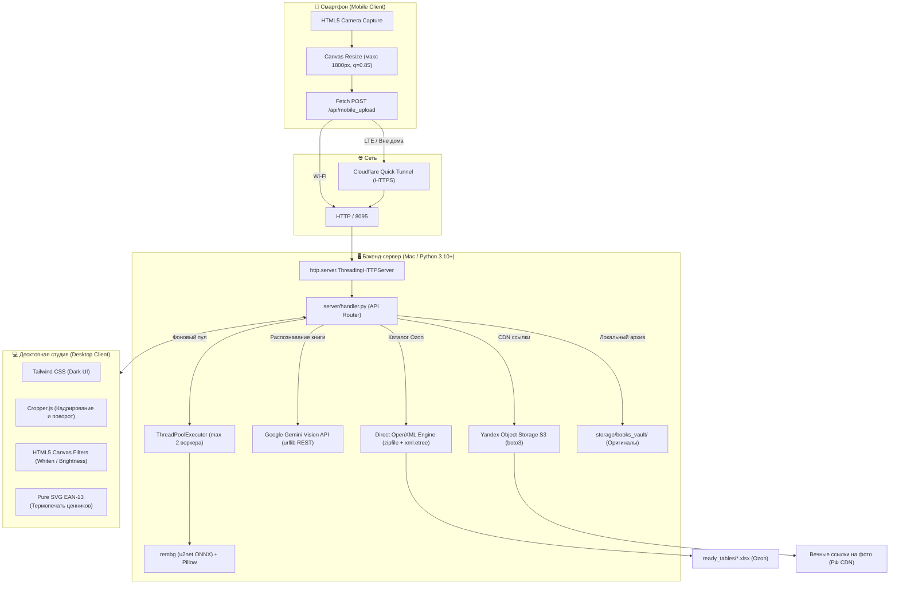

# 🛠️ Стек технологий и архитектура Bookinistic Studio

> **Назначение документа**: В этом документе наглядно и подробно описаны все технологии, инструменты и библиотеки, используемые в проекте **Bookinistic Studio**. Для каждого инструмента указаны его конкретная роль в системе, **плюсы**, **минусы** и **альтернативы** (почему был выбран именно он).

---

## 🗺️ Архитектурная схема взаимодействия компонентов

---

## 📊 Сводная таблица используемых технологий

| # | Инструмент / Технология | Роль в проекте | Плюсы (+) | Минусы (−) | Альтернативы и почему отклонены |
| :-: | :--- | :--- | :--- | :--- | :--- |
| **1** | **`http.server.ThreadingHTTPServer`** | Встроенный веб-сервер | Старт за 50 мс, нулевой оверхед, многопоточность из коробки, 0 сторонних зависимостей. | Нет декораторов роутинга и Swagger (роутинг пишется вручную). | *FastAPI / Django*: избыточны в десятки раз, тянут десятки внешних пакетов. |
| **2** | **`concurrent.futures.ThreadPoolExecutor`** | Фоновый пул вычислений | Защищает Mac от перегрева и фризов при тяжелой обработке фото нейросетью (`max_workers=2`). | Требует аккуратного контроля таймаутов и очередей задач. | *Celery / Redis*: избыточная серверная инфраструктура для локального приложения. |
| **3** | **Прямой OpenXML (`zipfile` + `xml.etree`)** | Запись в шаблоны Ozon | **Не ломает** скрытые листы, выпадающие списки и макросы Ozon. Запись строки за 15 мс. | Высокая сложность ручного контроля XML-узлов и индексов колонок. | *pandas / openpyxl*: затирают служебные листы Ozon, из-за чего модерация бракует файл. |
| **4** | **`Google Gemini Vision`** | ИИ-распознавание книги | Анализ за 3–6 сек, чтение дореволюционных шрифтов, ятей, советских колофонов. | Требует интернет и API-ключ (есть лимиты квот RPM). | *GPT-4o*: дороже, сложнее оплата в РФ. *Локальная LLaVA*: работает по 40–60 сек на книгу. |
| **5** | **Встроенный `urllib.request`** | REST-клиент к Gemini | 0 зависимостей, отсутствие конфликтов версий Protobuf и gRPC. | Больше шаблонного кода для обработки HTTP-ошибок. | *Официальный SDK `google-generativeai`*: тяжелый, часто ломается при обновлении зависимостей. |
| **6** | **`rembg` (`u2net`) + `onnxruntime`** | Локальное удаление фона | Полная автономность (работает офлайн), 0 руб затрат, студийный белый фон `#FFFFFF`. | Вес модели ~170 МБ, прогрев сессии при первом запуске ~1.5 сек. | *Remove.bg API*: стоит $0.20–$0.50 за фото (на 1000 книг — $200–$500). *OpenCV GrabCut*: оставляет рваные края. |
| **7** | **`Pillow (PIL)`** | Маски, резкость, сжатие | Мировой эталон растровой графики. Фильтр `UnsharpMask` дает четкий текст, `optimize=True` сжимает JPEG на 20%. | Не задействует GPU (для веб-разрешений 1800px этого и не требуется). | *OpenCV (cv2)*: избыточно тяжелый бинарник (~80 МБ). |
| **8** | **`Yandex Object Storage` (S3) + `boto3`** | Вечный CDN фото для Ozon | Дата-центры в РФ, мгновенное скачивание роботами Ozon, Mac можно сразу выключать. | Требует сервисного ключа Yandex Cloud. | *AWS S3*: риск санкционных блокировок. *Раздача с Mac*: требует держать ноутбук включенным сутками. |
| **9** | **`Cloudflare Quick Tunnel`** | Доступ со смартфона | Zero-Config: работает через LTE/5G без белого IP и проброса портов на роутере. Валидный HTTPS. | Публичный URL меняется при перезапуске туннеля. | *ngrok*: жесткие лимиты на бесплатном тарифе. *Локальный IP*: требует нахождения в одной Wi-Fi сети. |
| **10** | **`Tailwind CSS (CDN)`** | Стили и интерфейс | Быстрая декларативная верстка стильного Dark UI (Slate/Amber/Emerald) без сборщиков Webpack/Vite. | Много служебных классов в HTML-разметке. | *Bootstrap*: устаревший дизайн. *Чистый CSS с нуля*: разработка заняла бы недели. |
| **11** | **`Cropper.js`** | Кадрирование и горизонт | Аппаратное ускорение на Canvas, пропорции 3:4 Ozon, 1:1, шаг 1° доворота, плавный зум. | Требует аккуратного контроля жизненного цикла (`destroy`/`new`). | *Fabric.js*: избыточен. *Ручной Canvas*: пришлось бы с нуля писать сложную матричную математику. |
| **12** | **`HTML5 Canvas 2D` (на смартфоне)** | Клиентский ресайз фото | Ужимает фото 15 МБ до 300 КБ прямо в ОЗУ телефона. Пачка 30 фото улетает на Mac за 2 сек вместо 3 минут. | Кратковременная нагрузка на мобильный процессор при съемке. | *Отправка сырых 48 Мп фото*: забивает мобильную сеть и вызывает сетевые тайм-ауты. |
| **13** | **`Pure SVG EAN-13`** | Векторные этикетки | Бритвенная резкость 300+ DPI при термопечати (58×40 мм / 43×25 мм) для безошибочного сканирования Ozon. | Требует точной математики кодирования групп A/B/C и Guard Bars. | *Растровые картинки / шрифты*: размываются при термопечати и плохо считываются сканерами. |
| **14** | **`qrcode.js`** | QR-сопряжение с телефоном | Мгновенный коннект без ручного ввода IP-адресов: навел камеру смартфона — начал съёмку. | Не работает, если камера телефона физически повреждена. | *Ручной ввод IP-адреса и порта*: неудобно и приводит к опечаткам. |

---

## 🔍 Подробный разбор каждого инструмента по пунктам

---

### 1. Бэкенд-сервер: `http.server.ThreadingHTTPServer` (Python Standard Library)

* 📌 **Что делает**: Принимает входящие сетевые запросы от десктопного интерфейса (`/`), мобильного сканера (`/mobile`) и фоновые вызовы API (`/api/*`).
* ✅ **Плюсы**:
  - **Нулевой оверхед и мгновенный старт**: Запускается за 50 миллисекунд без прогрева виртуальных машин или компиляции.
  - **Многопоточность "из коробки"**: `ThreadingHTTPServer` автоматически запускает отдельный поток ОС на каждый входящий запрос. Загрузка пачки из 30 фото со смартфона не подвешивает интерфейс оператора на Mac.
  - **Стабильность**: Встроен в стандартную библиотеку Python — не сломается через год из-за изменений во внешних пакетах.
* ⚠️ **Минусы**:
  - Нет декларативных роутеров (типа `@app.get()`), логика маршрутизации прописана в методах `do_GET` и `do_POST` в `server/handler.py`.
* 🔄 **Альтернативы и почему отклонены**:
  - *FastAPI / Uvicorn*: Требует 50+ транзитивных зависимостей и асинхронной архитектуры (async/await), которую трудно подружить с синхронными блокирующими вызовами нейросетей и архивов.
  - *Django*: Чрезмерно громоздкий фреймворк (ORM, админка, миграции), абсолютно не нужный локальной студии.

---

### 2. Пул фоновых потоков: `concurrent.futures.ThreadPoolExecutor`

* 📌 **Что делает**: Изолирует ресурсоемкие операции вырезания фона книги через нейросеть `rembg` в отдельном пуле воркеров.
* ✅ **Плюсы**:
  - **Защита Mac от перегрузки**: Жесткое ограничение `max_workers=2` не позволяет процессу загрузить все ядра процессора на 100%, предотвращая шум вентиляторов и перегрев ноутбука.
  - **Абсолютная отзывчивость UI**: Пользователь может продолжать заполнять карточку, зуммировать или крутить фото, пока воркер обрабатывает снимок.
* ⚠️ **Минусы**:
  - Требует явной обработки очередей и таймаутов, чтобы избежать зависания «вечных» задач.
* 🔄 **Альтернативы и почему отклонены**:
  - *Celery + RabbitMQ / Redis*: Стандарт для корпоративных распределенных систем, но нелепо избыточен для десктопной утилиты на одном компьютере.

---

### 3. Движок Excel Ozon: Прямой OpenXML (`zipfile` + `xml.etree.ElementTree`)

* 📌 **Что делает**: Добавляет строки с описанием книг в официальные шаблоны Ozon (`Печатная книга_до 2011.xlsx` и `Печатная книга_после 2011.xlsx`).
* ✅ **Плюсы**:
  - **100% Сохранение структуры шаблона Ozon**: Шаблоны маркетплейса содержат скрытые служебные листы валидации, строгие XML-схемы типов, выпадающие списки выбора категорий и специфическое форматирование. Наш движок распаковывает файл как ZIP, точечно добавляет теги `<row>` в `sheet1.xml` и обновляет `sharedStrings.xml`. **Шаблон гарантированно не повреждается**.
  - **Молниеносная скорость**: Добавление книги занимает 10–15 миллисекунд.
  - **0 внешних зависимостей**: Работает на встроенных библиотеках Python.
* ⚠️ **Минусы**:
  - Высокая сложность поддержки: приходится вручную высчитывать координаты колонок (`A`...`CH`), следить за служебными XML-сущностями (`&amp;`, `&lt;`) и кодировкой UTF-8.
* 🔄 **Альтернативы и почему отклонены**:
  - *pandas / openpyxl*: Готовые библиотеки при сохранении полностью пересобирают Excel-файл со своими стилями. В 90% случаев они стирают скрытые формулы валидации Ozon, после чего личный кабинет Ozon выдает ошибку: *«Файл поврежден или не соответствует шаблону»*.

---

### 4. Искусственный интеллект: Google Gemini Vision (`gemini-3-flash-preview`)

* 📌 **Что делает**: Анализирует обложки и титульные листы книг, распознает выходные данные (автор, название, год, издательство, страницы, тираж, переплет) и формирует литературную аннотацию без мусорных хештегов.
* ✅ **Плюсы**:
  - **Чтение антиквариата**: Gemini превосходно считывает дореволюционную орфографию (яти, еры, фиту), старославянские буквицы, мелкие шрифты советских колофонов и старые типографские штампы.
  - **Высокая скорость (серия Flash)**: Время полного анализа книги составляет всего 3–6 секунд.
  - **Каскадная надежность**: Настроен автоматический фоллбэк: если флагманская модель перегружена, запрос мгновенно перехватывают `gemini-3.5-flash-lite` или `gemini-flash-lite-latest`.
* ⚠️ **Минусы**:
  - Требует стабильного подключения к интернету и API-ключа Google Gemini.
* 🔄 **Альтернативы и почему отклонены**:
  - *OpenAI GPT-4o*: Дороже по стоимости токенов, сложнее в оплате из РФ, имеет географические блокировки.
  - *Локальные модели (LLaVA / Qwen2-VL)*: Требуют от 16–32 ГБ видеопамяти на Mac и работают по 40–60 секунд на книгу, что не подходит для быстрой пакетной работы.

---

### 5. Связь с Gemini: Встроенный `urllib.request` (Чистый HTTP REST)

* 📌 **Что делает**: Отправляет JSON-запросы с base64-фотографиями на эндпоинты Google API.
* ✅ **Плюсы**:
  - **Никаких конфликтов версий**: Официальный SDK `google-generativeai` часто конфликтует с библиотеками `protobuf`, `grpcio` и C++ рантаймами.
  - **Полный контроль над таймаутами**: Мы напрямую контролируем заголовки, таймауты соединения и обработку HTTP-кодов (включая лимиты 429).
* ⚠️ **Минусы**:
  - Приходится вручную сериализовать JSON и декодировать потоки байт ответа.
* 🔄 **Альтернативы и почему отклонены**:
  - *requests*: Удобная библиотека, но `urllib` уже встроен в Python и справляется с задачей ничуть не хуже, не добавляя внешних зависимостей.

---

### 6. Студийное вырезание фона: `rembg` (`u2net`) + `onnxruntime`

* 📌 **Что делает**: Автоматически отделяет переплет книги от стола или фона и помещает её на чистый студийный белый фон `#FFFFFF`.
* ✅ **Плюсы**:
  - **Полная автономность (Offline)**: Нейросеть работает прямо на Mac через кроссплатформенный движок ONNX.
  - **0 рублей затрат**: Бесплатная обработка любого количества фотографий.
  - **Качество контура**: Модель `u2net` аккуратно обтравливает как четкие края книги, так и полуоткрытые страницы без рваных пикселей.
* ⚠️ **Минусы**:
  - Вес весов модели составляет ~170 МБ (скачивается автоматически один раз при первом старте).
  - Первый запуск требует ~1.5 сек на прогрев сессии ONNX в памяти.
* 🔄 **Альтернативы и почему отклонены**:
  - *Remove.bg API*: Дает отличное качество, но стоит $0.20–$0.50 за снимок (на 1000 книг затраты составили бы до $500).
  - *OpenCV GrabCut*: Ручные алгоритмы цветовой сегментации не справляются с бликами, тенями и сложными узорами на переплетах.

---

### 7. Графический конвейер: `Pillow (PIL)` с фильтрами `UnsharpMask`

* 📌 **Что делает**: Финальная сборка слоев после нейросети, наложение альфа-масок, повышение резкости текста и оптимизированное сжатие в JPEG.
* ✅ **Плюсы**:
  - **Микро-резкость текста**: Фильтр `ImageFilter.UnsharpMask(radius=1.2, percent=115, threshold=3)` делает буквы на корешке и тиснение обложки бритвенно-четкими.
  - **Экономия веса**: Параметр `optimize=True` сжимает JPEG на 15–20% эффективнее без артефактов.
* ⚠️ **Минусы**:
  - Работает на CPU, не задействуя видеокарту (для веб-разрешений 1800px мощности процессора Mac более чем достаточно).
* 🔄 **Альтернативы и почему отклонены**:
  - *OpenCV (cv2)*: Избыточно тяжелая библиотека (~80 МБ), менее приспособленная для предпечатной подготовки и компрессии полиграфических форматов.

---

### 8. Облачный CDN для Ozon: `Yandex Object Storage (S3)` + `boto3`

* 📌 **Что делает**: Загружает готовые фото в защищенный бакет (`another-piter-books1`) и генерирует вечные HTTPS-ссылки для колонок `Q` и `R` таблицы Ozon.
* ✅ **Плюсы**:
  - **Российские дата-центры**: Серверы Ozon забирают фото по прямому каналу связи внутри РФ за доли секунды без тайм-аутов.
  - **Независимость от компьютера**: Mac можно выключить сразу после нажатия кнопки «Записать книгу» — фото навсегда сохранены в облаке.
  - **Иммунитет к блокировкам**: Ссылки `storage.yandexcloud.net` стабильны и не блокируются РКН.
* ⚠️ **Минусы**:
  - Требует настройки бакета и сервисного аккаунта Yandex Cloud.
* 🔄 **Альтернативы и почему отклонены**:
  - *AWS S3*: Высокий риск блокировок со стороны РФ, проблемы с оплатой российскими картами.
  - *Раздача фото напрямую со своего Mac*: Требует держать ноутбук включенным сутками, пока роботы Ozon не скачают снимки.

---

### 9. Сетевой туннель: `Cloudflare Quick Tunnel` (`cloudflared`)

* 📌 **Что делает**: Создает безопасный HTTPS-туннель к вашему Mac при сканировании камерой смартфона.
* ✅ **Плюсы**:
  - **Zero-Config**: Не нужен «белый» IP, не требуется настраивать Port Forwarding на роутере и регистрировать домены.
  - **Работает через LTE/5G**: Смартфон может быть подключен к мобильному интернету, а компьютер — к домашней сети.
  - **Безопасный SSL (HTTPS)**: Мобильные браузеры (iOS Safari, Android Chrome) блокируют доступ к камере без шифрованного HTTPS. Cloudflare дает валидный доверенный сертификат автоматически.
* ⚠️ **Минусы**:
  - При перезапуске туннеля генерируется новый случайный адрес (проблема решена динамическим QR-кодом на экране).
* 🔄 **Альтернативы и почему отклонены**:
  - *ngrok*: Обязывает регистрироваться, имеет жесткие лимиты соединений на бесплатном аккаунте.
  - *Локальный IP (http://192.168.x.x:8095)*: Поддерживается сервером параллельно, но требует нахождения смартфона и Mac строго в одной Wi-Fi сети.

---

### 10. Фронтенд-стили: `Tailwind CSS (CDN)`

* 📌 **Что делает**: Обеспечивает стилизацию темного адаптивного интерфейса десктопной студии и мобильного сканера.
* ✅ **Плюсы**:
  - **Скорость создания UI**: Позволил собрать функциональный интерфейс (Slate-950, Amber, Emerald) без ручного написания тысяч строк CSS.
  - **Без сборщиков**: Подключается одной строкой через CDN, не требуя Node.js, npm, Webpack или Vite.
* ⚠️ **Минусы**:
  - Раздувает HTML-разметку большим количеством служебных классов.
* 🔄 **Альтернативы и почему отклонены**:
  - *Bootstrap*: Морально устаревший дизайн, плохо приспособленный под темные полиграфические темы.
  - *Чистый CSS с нуля*: Занял бы недели ручной верстки.

---

### 11. Студийный редактор: `Cropper.js`

* 📌 **Что делает**: Обеспечивает свободное кадрирование, пропорции 3:4 Ozon, 1:1, поворот на 90°, точный доворот горизонта с шагом 1°, плавный зум колесиком и перемещение фото (Pan).
* ✅ **Плюсы**:
  - Аппаратное ускорение через Canvas.
  - Проверенная годами библиотека для точных матричных манипуляций с изображениями в веб-браузерах.
  - Поддерживает экспорт выделенной области через `getCroppedCanvas()` без интерполяционных искажений.
* ⚠️ **Минусы**:
  - Требует внимательного управления жизненным циклом (уничтожение старого экземпляра `destroy()` перед загрузкой нового кадра).
* 🔄 **Альтернативы и почему отклонены**:
  - *Fabric.js*: Слишком тяжелая библиотека, предназначенная для сложных векторных редакторов, а не для фотокадрирования.
  - *Ручной Canvas*: Потребовал бы сотен строк кода для математики аффинных преобразований, тач-жестов и скролла.

---

### 12. Клиентское сжатие: `HTML5 Canvas 2D API` (на смартфоне)

* 📌 **Что делает**: В `mobile.html` прямо в браузере смартфона сжимает тяжелые фотографии с камеры (12–15 МБ, 48 Мп) до веб-формата (макс. сторона 1800 px, JPEG 0.85).
* ✅ **Плюсы**:
  - **Ускорение в 20 раз**: Пачка из 30 фото весит всего ~9 МБ вместо 400 МБ и улетает на Mac за пару секунд даже при слабом мобильном интернете.
  - Разгружает процессор Mac от первичного декодирования огромных файлов.
* ⚠️ **Минусы**:
  - Кратковременно нагружает процессор телефона при выборе пачки снимков (на современных смартфонах занимает доли секунды).
* 🔄 **Альтернативы и почему отклонены**:
  - *Передача исходных фото*: Приводила бы к забиванию интернет-канала, сбоям сети и долгому ожиданию загрузки.

---

### 13. Термопечать ценников: Векторный `Pure SVG EAN-13 Generator`

* 📌 **Что делает**: Генерирует математически точный векторный штрихкод стандарта EAN-13 прямо в браузере для печати на термопринтерах этикеток (58×40 мм / 43×25 мм).
* ✅ **Плюсы**:
  - **Идеальная четкость (300+ DPI)**: SVG состоит из чистых прямоугольников `<rect>` и текста. При печати на термопринтере полосы не имеют растрового размытия («мыла»), что гарантирует мгновенное считывание сканерами на складах Ozon.
  - **Автономность**: Не требует установки специальных шрифтов штрихкода в операционную систему.
* ⚠️ **Минусы**:
  - Требует строгой математической реализации кодирования полос по стандарту GS1 (группы A, B, C и защитные знаки Guard Bars).
* 🔄 **Альтернативы и почему отклонены**:
  - *Растровый PNG/Canvas*: При масштабировании дает ступеньки и размытие, из-за чего складские сканеры не могут прочитать штрихкод.

---

### 14. Сопряжение устройств: `qrcode.js`

* 📌 **Что делает**: Генерирует динамический QR-код на экране Mac со ссылкой на мобильный интерфейс загрузки.
* ✅ **Плюсы**:
  - **Мгновенный коннект**: Оператор наводит камеру смартфона на монитор и сразу попадает в сканер без ручного ввода длинных IP-адресов или токенов.
  - Работает локально прямо в браузере без обращения к внешним серверам генерации QR-кодов.
* ⚠️ **Минусы**:
  - Не поможет, если у смартфона физически сломана камера (в этом случае в интерфейсе предусмотрен текстовый URL для ручного ввода).
* 🔄 **Альтернативы и почему отклонены**:
  - *Внешние API генераторов QR*: Зависят от интернета и создают задержку при открытии модального окна.

---

## 🎯 Сводка ключевых принципов системы

1. **Минимум внешних зависимостей (Zero Bloatware)**:
   Отказ от тяжелых фреймворков в пользу стандартной библиотеки гарантирует, что система работает стабильно и не сломается через год из-за обновлений зависимостей.
2. **100% Соответствие требованиям Ozon**:
   Каждая строчка генерации OpenXML, формата штрихкода и ссылок S3 спроектирована строго под регламенты модерации Ozon 2026 года.
3. **Безопасность оригиналов (Non-Destructive)**:
   Исходные снимки с камеры (`cameraOriginal`) всегда остаются нетронутыми в архиве. Любая обрезка, отбеливание или поворот обратимы в один клик.
4. **Субсекундная отзывчивость**:
   Визуальные инструменты (зум, кадрирование, перемещение) работают локально на видеокарте в браузере с частотой 60 кадров/сек, а фоновые вычисления изолированы в пуле потоков.
