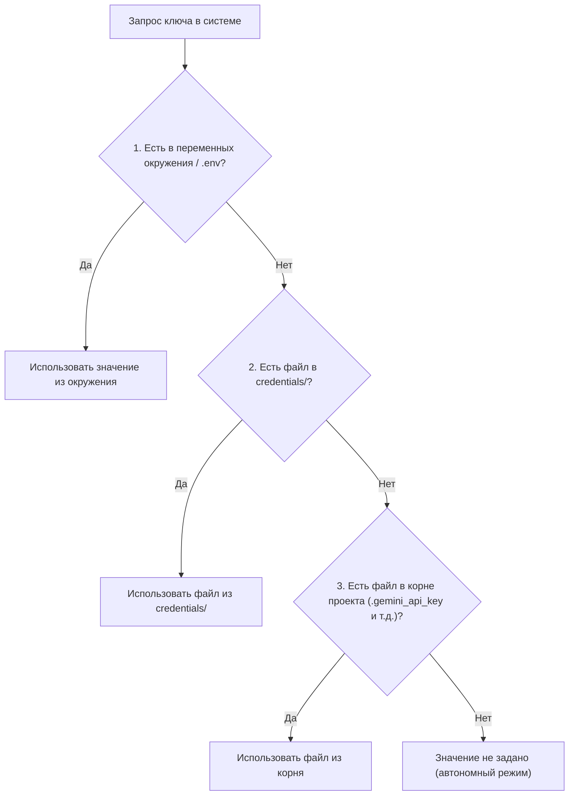

# 🔑 Справочник по ключам, API и доступам Bookinistic Studio

В этом документе собрана полная информация обо всех ключах доступа, внешних сервисах, способах их настройки и приоритетах загрузки в системе.

---

## 🗺️ Сводная карта ключей и сервисов

| № | Сервис / API | Переменные в `.env` | Локальный файл | Обязательность | Назначение в проекте |
| :-: | :--- | :--- | :--- | :-: | :--- |
| **1** | **Google Gemini AI** | `GEMINI_API_KEY` | `.gemini_api_key`<br>`credentials/.gemini_api_key` | **ОБЯЗАТЕЛЕН** | ИИ-распознавание фото: название, автор, год, мантра, бумага, аннотация, дефекты |
| **2** | **Ozon Seller API** | `OZON_CLIENT_ID`<br>`OZON_API_KEY` | `.ozon_credentials`<br>`credentials/.ozon_credentials` | *Опционален* | Синхронизация каталога магазина (1796 товаров), брендов, проверка статусов |
| **3** | **Yandex Object Storage (S3)** | `S3_BUCKET`<br>`S3_KEY_ID`<br>`S3_SECRET_KEY`<br>`S3_ENDPOINT_URL`<br>`S3_REGION_NAME` | `.yandex_s3_credentials`<br>`credentials/.yandex_s3_credentials` | *Опционален* | Публичный CDN для фото книг (прямые HTTPS ссылки) и облачный бэкап базы данных |
| **4** | **Cloudflare Tunnel** | *(Не требует ключей)* | Бинарник `cloudflared` | *Опционален* | Удаленное подключение смартфона по Wi-Fi / 4G без белого IP для съемки книг |

---

## 1. 🤖 Google Gemini API (Искусственный Интеллект)

### Назначение
Сердце автоматизации студии. Используется моделями `gemini-2.5-flash` и мультимодальным зрением для:
- Распознавания титульного листа, обложки и корешка книги.
- Извлечения авторов (автор на обложке vs официальный паспортный автор).
- Чтения выходных сведений («мантры»): год, тираж, издательство, тип бумаги (офсетная, типографская и т.д.).
- Составления профессиональной букинистической аннотации с фиксацией дефектов.

### Где получить ключ
1. Перейдите в [Google AI Studio](https://aistudio.google.com/app/apikey).
2. Войдите под своим Google-аккаунтом.
3. Нажмите **«Create API key»**.
4. Скопируйте созданный ключ (начинается с `AIzaSy...`).
> [!NOTE]
> Бесплатного тарифа Google AI Studio (Free Tier) с запасом хватает на непрерывную каталогизацию сотен книг в день.

### Способы настройки (на выбор)
1. **Через веб-интерфейс** *(самый простой)*:
   - В правом верхнем углу интерфейса студии нажмите кнопку **«Gemini Key»**.
   - Вставьте ключ в модальное окно и нажмите «Сохранить».
   - Ключ запишется в файл `.gemini_api_key`.
2. **Через файл `.gemini_api_key`**:
   - Создайте файл `.gemini_api_key` в корне проекта или в папке `credentials/`.
   - Вставьте ключ одной строкой:
     ```text
     AIzaSyYourSecretKeyHere...
     ```
3. **Через файл `.env`**:
   ```bash
   GEMINI_API_KEY=AIzaSyYourSecretKeyHere...
   ```

---

## 2. 🛍️ Ozon Seller API

### Назначение
Используется для взаимодействия с вашим личным кабинетом продавца на Ozon:
- Первоначальный и периодический импорт существующих карточек книг в локальную базу `storage/catalog.db` (1796 товаров).
- Выгрузка реального реестра брендов Ozon (397 брендов), чтобы автодополнение не предлагало лишнего.
- Проверка уникальности артикулов и штрихкодов.

> [!NOTE]
> Если ключи Ozon API не указаны, студия **продолжает полноценно работать в автономном режиме**: формирует готовые Excel-файлы выгрузки по официальным стандартам Ozon для последующей ручной загрузки через кабинет продавца.

### Где получить ключи
1. Войдите в личный кабинет [Ozon Seller](https://seller.ozon.ru/).
2. Перейдите в раздел: **Настройки** $\to$ **API ключи**.
3. Скопируйте ваш **Client ID** (числовой идентификатор магазина).
4. Нажмите **«Создать ключ»**:
   - Название: `Bookinistic Studio`
   - Роль / Тип токена: **«Товары»** (или «Администратор»).
5. Скопируйте сгенерированный API-ключ.

### Способы настройки
1. **Через веб-интерфейс**:
   - В шапке сайта нажмите кнопку с синим бейджем **«Ozon API»**.
   - Введите Client ID и API Key, нажмите «Сохранить».
   - Нажмите «Синхронизировать сейчас» для обновления каталога.
2. **Через файл `.ozon_credentials`**:
   - Создайте файл `.ozon_credentials` в папке `credentials/` (или в корне):
     ```json
     {
       "client_id": "1234567",
       "api_key": "xxxxxxxx-xxxx-xxxx-xxxx-xxxxxxxxxxxx"
     }
     ```
3. **Через файл `.env`**:
   ```bash
   OZON_CLIENT_ID=1234567
   OZON_API_KEY=xxxxxxxx-xxxx-xxxx-xxxx-xxxxxxxxxxxx
   ```

---

### 🛡️ Гайд по токенам Ozon Seller API: типы, роли и безопасность

В личном кабинете Ozon Seller вы можете выпускать ключи с разным уровнем доступа (ролями). Никогда не создавайте ключ «Администратор» для интеграций, которым нужен доступ только к одной задаче!

| Роль токена на Ozon | Уровень риска | Что разрешено делать | Кому можно давать |
| :--- | :---: | :--- | :--- |
| **Товары (Products)**<br>*(Используется в Bookinistic)* | 🟢 **БЕЗОПАСНО**<br>*(Риск: 2/10)* | • Чтение каталога товаров и характеристик<br>• Создание и редактирование карточек<br>• Доступ к официальным справочникам Ozon<br>🚫 **НЕТ** доступа к деньгам, заказам, покупателям и ценам | Сервисам каталогизации, контент-студиям, Bookinistic Studio, фотографам |
| **Сообщения и отзывы (Chats / Reviews)** | 🟢 **БЕЗОПАСНО**<br>*(Риск: 3/10)* | • Чтение отзывов и вопросов о товарах<br>• Публикация ответов покупателям<br>• Переписка в чатах поддержки Ozon<br>🚫 **НЕТ** доступа к финансам, карточкам, заказам | Чат-ботам с ИИ (автоответы на отзывы «Спасибо за покупку!»), менеджерам поддержки |
| **Аналитика (Analytics)** | 🟡 **СРЕДНИЙ**<br>*(Риск: 4/10)* | • Чтение отчетов по продажам, конверсиям, воронке<br>• Просмотр позиций товаров в поиске<br>🚫 **НЕТ** права менять цены или товары | Сервисам аналитики (MPSTATS, MarketGuru), маркетологам |
| **Финансы (Finance)** | 🟡 **СРЕДНИЙ**<br>*(Риск: 5/10)* | • Просмотр начислений, актов, истории выплат<br>• Отчеты о реализации, комиссии и логистика<br>🚫 **НЕТ** возможности перевести деньги на другой счет (только чтение) | Бухгалтерии, внешним сервисам финучета (Контур, МойСклад, 1С) |
| **Заказы / Логистика (Orders / FBS / FBO)** | 🟡 **СРЕДНИЙ**<br>*(Риск: 6/10)* | • Просмотр отправлений и персональных данных клиентов (ФИО, адрес, телефон)<br>• Сборка заказов, печать маркировочных этикеток Ozon<br>• Смена статусов доставки | Складам, фулфилмент-центрам, курьерским интеграциям |
| **Цены и остатки (Prices & Stocks)** | 🟠 **ПОВЫШЕННЫЙ**<br>*(Риск: 7/10)* | • Изменение цен и установка скидок<br>• Обнуление или выставление остатков на складах FBS<br>⚠️ Опасность: сбойный бот может уронить цены до 1 рубля или скрыть товары | Проверенным репрайсерам, складским системам учета остатков (1С) |
| **Реклама (Performance API)** | 🟠 **ПОВЫШЕННЫЙ**<br>*(Риск: 7/10)* | • Создание и запуск кампаний («Трафареты», продвижение)<br>• Управление ставками и дневными бюджетами<br>⚠️ Опасность: неконтролируемый слив рекламного бюджета | Сертифицированным агентствам контекстной/маркетплейс рекламы |
| **Администратор (Admin)** | 🔴 **КРИТИЧЕСКИЙ**<br>*(Риск: 10/10)* | • **Полный неограниченный доступ ко всему магазину**<br>• Управление всеми API-ключами, финансами, товарами, ценами, складами | **НИКОМУ НЕ ПЕРЕДАВАТЬ!** Использовать исключительно владельцу аккаунта для личных нужд |

> [!IMPORTANT]
> **Золотое правило безопасности Ozon API**:
> 1. Для каталогизации в Bookinistic Studio выпускайте **строго токен с ролью «Товары»**!
> 2. Создавайте **отдельный ключ** для каждого внешнего сервиса с понятным именем (например: `Bookinistic-Studio-Mac`, `MPSTATS-Analytics`).
> 3. Если вы прекращаете работу с подрядчиком или сервисом — просто удалите его токен в ЛК Ozon в 1 клик без ущерба для остальных интеграций.

---

## 3. ☁️ Yandex Object Storage (S3 CDN)

### Назначение
Используется для облачного хостинга фотографий и резервного копирования базы данных:
- Загрузка обработанных фото книги (главное фото и до 14 дополнительных).
- Генерация прямых публичных HTTPS ссылок (`https://storage.yandexcloud.net/bucket/books/...`), которые автоматически подставляются в колонки `Q` и `R` файла Excel.
- Автоматический бэкап файла базы данных SQLite `storage/catalog.db` в защищенное облачное хранилище.

> [!TIP]
> **Автономный режим без S3**: если Yandex S3 не настроен, система автоматически сохраняет все обработанные фотографии в локальный архив `storage/books_vault/[артикул]/`. В таблице Excel генерируются локальные ссылки, а по кнопке **«📦 ZIP с фото»** в интерфейсе можно в один клик скачать архив для пакетной загрузки изображений в личном кабинете Ozon.

### Где получить ключи
1. Войдите в консоль [Yandex Cloud](https://cloud.yandex.ru/).
2. Перейдите в раздел **Object Storage** и создайте бакет с **публичным чтением** для фотографий.
3. В разделе **Сервисные аккаунты** создайте сервисный аккаунт с ролью `storage.editor`.
4. Создайте **статический ключ доступа** для сервисного аккаунта.
5. Скопируйте **Идентификатор ключа (Key ID)** и **Секретный ключ (Secret Key)**.

### Способы настройки
1. **Через файл `.yandex_s3_credentials`**:
   - Создайте файл `.yandex_s3_credentials` в корне или в `credentials/`:
     ```json
     {
       "bucket": "your-book-bucket-name",
       "key_id": "YCAJExxxxxxxxxxxxxxx",
       "secret_key": "YCPxxxxxxxxxxxxxxxxxxxxxxxxxxxxxxxxxxxx",
       "endpoint_url": "https://storage.yandexcloud.net",
       "region_name": "ru-central1"
     }
     ```
2. **Через файл `.env`**:
   ```bash
   S3_BUCKET=your-book-bucket-name
   S3_KEY_ID=YCAJExxxxxxxxxxxxxxx
   S3_SECRET_KEY=YCPxxxxxxxxxxxxxxxxxxxxxxxxxxxxxxxxxxxx
   S3_ENDPOINT_URL=https://storage.yandexcloud.net
   S3_REGION_NAME=ru-central1
   ```

---

### 📸 Жизненный цикл фото: можно ли удалять из Yandex S3 после создания карточки?

**ОТВЕТ: ДА, МОЖНО!** 

Вот как устроен цикл хранения фото между Yandex S3, Ozon и Bookinistic Studio:

1. **Как Ozon обрабатывает фото из Excel**:
   - Когда вы загружаете готовую таблицу Excel на Ozon, роботы маркетплейса обращаются по ссылкам из колонок `Q` и `R` к вашему бакету Yandex S3.
   - Ozon **скачивает изображения на свои собственные серверы** (Ozon CDN: `https://ir.ozone.ru/s3/multimedia-...`), оптимизирует их в форматы WebP/JPEG, генерирует превью разного разрешения и сохраняет их в своей постоянной базе навсегда.
   - Как только карточка книги прошла модерацию и опубликована в магазине, **Ozon больше НИКОГДА не обращается к вашему бакету Yandex S3**!

2. **Как хранятся фото в карточках, подгруженных из базы Ozon (`catalog.db`)**:
   - При синхронизации каталога через Ozon API (`services/ozon_service.py`) в локальную базу `storage/catalog.db` записываются **прямые ссылки на внутренний CDN самого Ozon** (`https://ir.ozone.ru/...`).
   - Они вообще **не занимают места ни в вашем Yandex S3, ни на диске вашего Mac**! При просмотре в интерфейсе они подгружаются напрямую с серверов Ozon.

3. **Что происходит с локальными фото на вашем Mac**:
   - При съемке и сохранении каждой книги оригинал фото всегда сохраняется в локальном архиве: `storage/books_vault/[артикул]/` (например: `storage/books_vault/DP-B-02733/main.jpg`).
   - Поэтому даже если вы очистите бакет Yandex S3, у вас на компьютере всегда остается архив исходников для каждой отснятой книги.

> [!TIP]
> **Рекомендация по экономии на Yandex Cloud**:
> Чтобы бакет не разрастался со временем и не капала лишняя плата за хранилище:
> 1. В консоли Yandex Cloud перейдите в ваш бакет $\to$ вкладка **«Управление жизненным циклом» (Lifecycle)**.
> 2. Добавьте простое правило: **«Удалять объекты старше 30 или 60 дней»**.
> 3. За 30 дней карточка Ozon гарантированно проходит модерацию и сохраняет фото к себе, а старые файлы в Yandex S3 автоматически удаляются, сохраняя баланс облака близким к нулю!

---

## 4. 🚀 Cloudflare Tunnel (`cloudflared`)

### Назначение
Позволяет подключить смартфон фотографа к студии без сложной настройки роутера, белого IP и проброса портов:
- На Mac поднимается локальный сервер на порту `8095`.
- Утилита `cloudflared` автоматически открывает защищенный HTTPS-туннель (Quick Tunnel).
- В интерфейсе генерируется QR-код. Фотограф наводит камеру телефона, открывает веб-приложение съемки и отправляет фотографии напрямую в студию.

### Ключи и авторизация
- **КЛЮЧИ НЕ ТРЕБУЮТСЯ**.
- Cloudflare Quick Tunnels работают бесплатно и без авторизации.
- Бинарный файл `cloudflared` уже находится в корне проекта и управляется модулем `tunnel_manager.py`.

---

## ⚡ Приоритет загрузки ключей в системе

При запуске и выполнении запросов система ищет ключи в следующем строгом порядке (первое найденное значение имеет приоритет):



---

## 🔒 Безопасность и Git

Все секретные файлы и токены надежно защищены от случайной публикации в Git:

1. Файлы `.gemini_api_key`, `.ozon_credentials`, `.yandex_s3_credentials`, `.env`, а также каталог `credentials/` внесены в [`.gitignore`](file:///Users/igor/Projects/real_projects/bookinistic/.gitignore).
2. Для удобства новых установок в проекте поддерживается единый файл-образец [`.env.example`](file:///Users/igor/Projects/real_projects/bookinistic/.env.example).
3. Права доступа к файлам с ключами рекомендуется выставлять как `600` (`chmod 600 .ozon_credentials .gemini_api_key .yandex_s3_credentials`).

