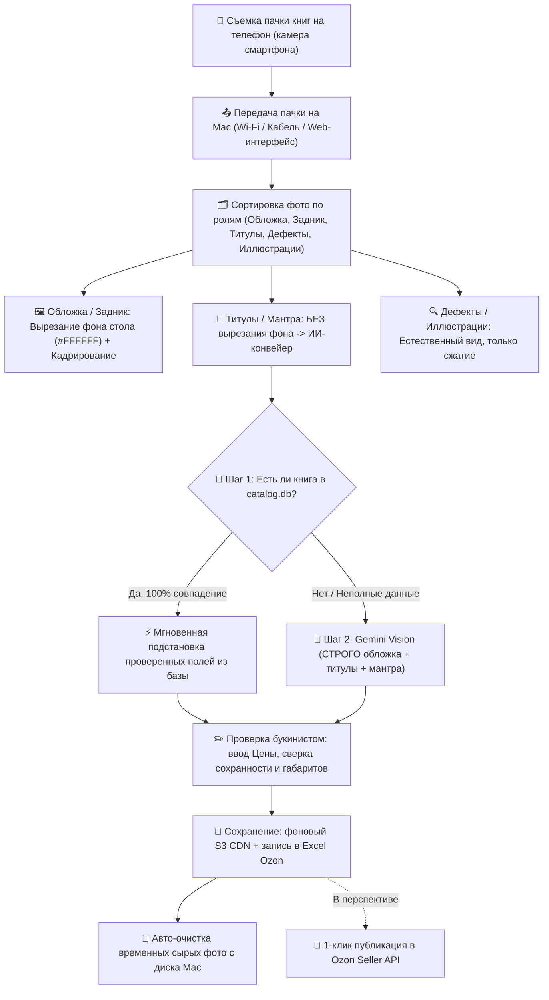
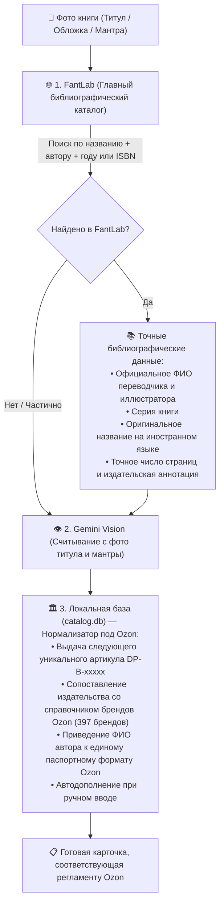

# 📑 Техническая спецификация (SRS): Bookinistic Studio

> **Версия**: 1.0  
> **Статус**: Утверждена в разработку  
> **Назначение**: Автоматизация создания карточек букинистических книг для маркетплейса Ozon с минимальной рутиной.

---

## 1. 🎯 Цель и назначение системы

Система предназначена для букинистического магазина («Другой Петербург»).  
**Главная цель**: сократить время подготовки и публикации одной книги с 3–5 минут до 30–50 секунд, исключив ручной набор библиографических данных, расчет веса/габаритов, ручную заливку фото в облако и возню со сложными правилами Ozon.

---

## 2. 🔄 Пользовательский процесс (Workflow)

---

## 3. 📸 Регламент работы с фотографиями

### 3.1. Роли, количество кадров и строгий порядок в карточке Ozon
* **Минимум**: 2–4 фото (Лицевая обложка, задник, 1–2 титульных/выходных листа).
* **Максимум (сложные книги/комплекты)**: до 10 фото (обложка, задник, титулы, 2–3 иллюстрации, 2–3 фото дефектов).
* **Строгий порядок в карточке Ozon**:
  1. `01_cover_front.jpg` — **Лицевая обложка** (Главное фото карточки Ozon).
  2. `02_defect_<N>.jpg` — **Дефекты книги по порядку** (если есть; первые доп. фото).
  3. `03_illustration_<N>.jpg` — **Иллюстрации и развороты** (если есть; идут перед задником).
  4. `04_cover_back_<N>.jpg` — **Задняя сторона переплета** (в конце перед карточкой; для комплектов — задники всех книг).
  5. `99_card.jpg` — **Фирменная шаблонная карточка магазина** с предупреждением (всегда финальное доп. фото).
  * 🚫 **Титульные листы и мантра** (`info_page_<N>.jpg`) — сохраняются ТОЛЬКО локально и в облачном архиве для сверки, в витрину Ozon **НЕ попадают**.

### 3.2. Правила удаления фона (`rembg`)
1. **Титульные листы и страницы с текстом**: 
   - 🚫 **Категорически запрещено вырезать фон нейросетью**. Это страницы книги с белой/кремовой бумагой; алгоритм удаляет сам лист или портит текст. Кадры сохраняют оригинальный разворот книги.
2. **Лицевая обложка (`cover_front`) и оборот переплета (`cover_back`)**:
   - ✅ Применяется удаление фона стола и замена на чистый белый `#FFFFFF`.
   - Защита белых книг: если обложка белая/светлая, контур определяется по границам блока без срезания самой обложки.
3. **Иллюстрации и дефекты**:
   - По умолчанию сохраняются в естественном виде (без обтравки).
   - В интерфейсе фоторедактора сохраняется ручная кнопка «Вырезать фон ИИ» на случай нестандартных предметов или отдельного корешка.

### 3.3. Кадрирование (Cropper)
* Алгоритм автоматического определения рамки книги должен работать предсказуемо с безопасным отступом (+3–4%).
* Инструмент ручного кадрирования в студии должен быть мгновенным, с пропорциями Ozon (3:4) и возможностью быстрого сброса на исходник.

---

## 4. 🧠 Интеллектуальное наполнение карточки (Источники данных и их роли)

В букинистике каждая поступающая книга уникальна, поэтому поиск и нормализация информации разделены по зонам ответственности:

### 4.1. Зоны ответственности каждого источника:

1. **FantLab (Лаборатория Фантастики) — Главный библиографический эталон**:
   - Ищет конкретное издание по автору, названию и году выпуска (или по ISBN, если он есть).
   - Извлекает: книжную серию, оригинальное название для переводных книг (`original_title`), паспортные ФИО переводчиков и художников-иллюстраторов, проверенную аннотацию.

2. **Google Gemini Vision AI — Зрение и распознавание экземпляра**:
   - Считывает данные **строго с информационных фото** (титульный лист, оборот, колофон/мантра).
   - Заполняет данные, если книги нет в FantLab (редкие советские, научные или дореволюционные издания).
   - Определяет тип обложки (твердый переплет, мягкий, бумвинил, ткань) и формулирует аннотацию своими словами.
   - 🚫 *Иллюстрации и дефекты в Gemini не отправляются*.

3. **Локальная база (`catalog.db`) — Внутренний реестр и нормализатор Ozon**:
   - **Генерация артикулов**: выдает следующий сквозной номер `DP-B-xxxxx` по порядку.
   - **Реестр брендов Ozon**: сверяет издательство с базой 397 проверенных брендов магазина, чтобы модерация Ozon не блокировала карточку (ставит утвержденный бренд либо «Нет бренда»).
   - **Канонизация авторов**: сверяет автора с базой 1 310 канонических авторов магазина.
   - **Словари автодополнения**: ускоряет ручной ввод серии, издательства и переводчиков прямо в интерфейсе.
   - **Хранение архива**: история всех созданных магазином товаров с возможностью поиска.

---

## 5. ✏️ Ручные поля и формулы расчета

1. **Цена продажи**: Всегда задается букинистом вручную. ИИ и база оставляют поле пустым.
2. **Габариты (Ш х Д х В) и вес**:
   - Рассчитываются стартово по формулам ГОСТ (доля типографского листа: `84x108/32`, `60x90/16`, `70x100/16` + страницы + тип переплета).
   - **Принцип независимости**: поля не связаны жестко; изменение количества страниц или типа бумаги после ручной правки размеров пользователем **не перезаписывает** введенные вручную числа.
3. **Сохранность книги**:
   - Нет фото дефектов в слоте $\to$ автоматически выставляется **«Очень хорошая»**.
   - Есть хотя бы 1 фото в слоте дефектов $\to$ автоматически выставляется **«Хорошая»**.
   - **«Удовлетворительная»** $\to$ выставляется **ТОЛЬКО вручную букинистом** (автоматически никогда не выбирается).

---

## 6. ☁️ Хранилище, облако S3 и жизненный цикл файлов

1. **Yandex Object Storage (S3 CDN)**:
   - Основное хранилище готовых изображений для витрины Ozon (бакет `another-piter-books1`).
   - Изображения получают постоянные публичные HTTPS-ссылки.
2. **Жизненный цикл локальных файлов на Mac**:
   - Сырые фотографии с камеры телефона (`inbox`, `session_photos`) являются **временными**.
   - Они хранятся на диске только на время сборки сессии.
   - После того как карточка книги записана в таблицу/базу и фото успешно улетели в S3, сырые тяжелые исходники подлежат автоматической очистке/ротации, чтобы диск Mac не забивался гигабайтами временных фото.

---

## 7. 📊 Выгрузка в Ozon

1. **Текущий этап (Этап 1)**:
   - Формирование валидной таблицы Excel по официальным шаблонам Ozon (`до 2011` — 81 колонка, `после 2011` — 86 колонок).
   - Строгая изоляция XML без повреждения служебных листов и формул маркетплейса.
2. **Перспективный этап (Этап 2)**:
   - Прямая безопасная интеграция с Ozon Seller API (`POST /v3/product/import`).
   - Кнопка «Опубликовать в Ozon» с валидацией обязательных атрибутов перед отправкой.
   - Excel сохраняется как резервная копия и локальный архив.

---

## 🗺️ Дорожная карта реализации (Roadmap)

| Этап | Задача | Ожидаемый результат |
| :---: | :--- | :--- |
| **Шаг 1** | **Оптимизация фото-конвейера** | Полный запрет `rembg` для титулов и дефектов; вырезание фона только для обложки/задника. Ускорение загрузки пачки в 5 раз. |
| **Шаг 2** | **Оптимизация ИИ-распознавания** | Передача в Gemini строго обложки + титула + колофона (без иллюстраций и дефектов). Подключение сверки с базой `catalog.db` до вызова ИИ. |
| **Шаг 3** | **Упреждающая выгрузка в S3** | Загрузка фото в Yandex S3 в фоновом режиме сразу при добавлении в слот. Запись карточки за 0.2 секунды. |
| **Шаг 4** | **Очистка диска и памяти** | Ротация и авто-очистка временных фото на Mac после публикации. Избавление фронтенда от Base64 в DOM. |
| **Шаг 5** | **Подключение Ozon Seller API** | Создание карточки в Ozon в 1 клик через API с сохранением генерации Excel как резервной копии. |

