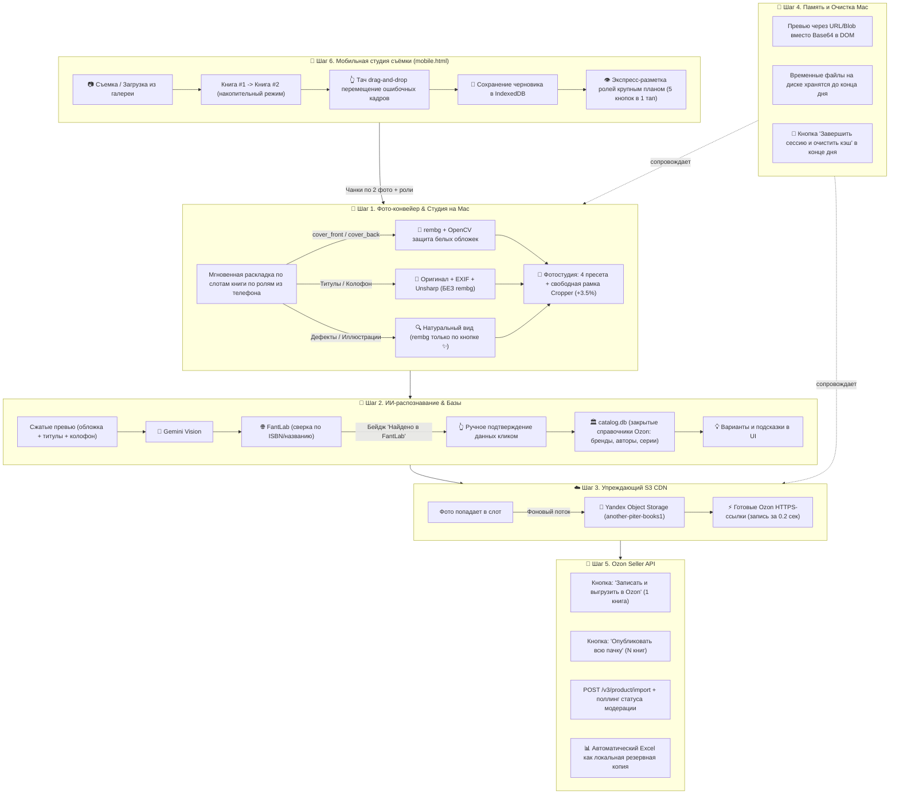

# 📑 Генеральный план модернизации Bookinistic Studio (Шаги 1–6)

> **Назначение**: Комплексный эталонный документ развития системы автоматизации создания карточек книг для Ozon («Другой Петербург»).  
> **Статус**: Утвержден к поэтапной разработке.

---

## 🗺️ Общая архитектурная карта системы

---

## 📋 Согласованные решения по блокам

### 📱 Шаг 6: Мобильная студия съёмки (`mobile.html`)
* **Гибридный ввод**: выбор пачки из галереи + оперативный досъём забытых страниц через встроенную камеру.
* **Накопительный режим**: пошаговое добавление книг кнопкой `«+ След. книга»` с отправкой всей готовой пачки в конце.
* **Тач-перемещение кадров**: долгое нажатие (long-press) позволяет перетянуть ошибочно снятый кадр из блока одной книги в другую.
* **Обязательная экспресс-разметка ролей**: перед отправкой каждый кадр выводится крупно с 5 кнопками в 1 тап (`Обложка`, `Задник`, `Титул`, `Дефект`, `Иллюстрация`). На Mac фото сразу попадают в свои слоты.
* **Защита от потери данных**: автоматическое сохранение черновика в `IndexedDB` смартфона.

---

### 📸 Шаг 1: Оптимизация фото-конвейера на Mac
* **Селективный `rembg`**:
  * Запуск автоматически только для слотов `cover_front` и `cover_back`.
  * Титульные листы, текст и мантра — строгий запрет на `rembg`.
  * Дефекты и иллюстрации — естественный вид, вырезание доступно точечно по кнопке `✨` на карточке (`force_rembg=True`).
* **Защита белых/светлых переплетов (`OpenCV`)**:
  * Анализ контура и целостности книги в `services/image_service.py`. Если альфа-маска вырезает внутренности обложки или фон близок к цвету книги, тело книги заливается 100% непрозрачностью, а отбеливается только стол вокруг.
* **Кадрирование Cropper**:
  * Свободная рамка строго по контуру книги с безопасным отступом `+3.5%`. Кнопка переключения в `3:4` в тулбаре студии.
  * Если оператор не кадрировал фото вручную, при записи книги обложка кадрируется автоматически по контуру (+3.5%).
* **Пресеты в студии**:
  * 📝 «Четкий текст» (`contrast: +18, brightness: +3`)
  * 🎨 «Яркие иллюстрации» (`saturation: +15, contrast: +8`)
  * ⚪ «Чистый фон» (`whiten: 75, contrast: +5`)
  * ↩️ «Сброс в ноль» (все бегунки в 0)
* **Строгий порядок в карточке Ozon**:
  1. `01_cover_front.jpg` — Лицевая обложка (Главное фото).
  2. `02_defect_<N>.jpg` — Дефекты книги по порядку (если есть; первые доп. фото).
  3. `03_illustration_<N>.jpg` — Иллюстрации и развороты (если есть; идут перед задником).
  4. `04_cover_back_<N>.jpg` — Задняя сторона переплета (в конце перед карточкой).
  5. `99_card.jpg` — Фирменная шаблонная карточка магазина с предупреждением (финальное доп. фото).
  * 🚫 Титульные листы (`info_page`) сохраняются только в архиве и в витрину Ozon не идут.
* **Интерфейс**: удаление избыточной кнопки «✨ ИИ-вырезать фон пачке» из панели пула.

---

### 🧠 Шаг 2: Оптимизация ИИ-распознавания (Gemini + FantLab + catalog.db)
* **Минимизация токенов и ускорение Gemini**:
  * Передача строго информационных фото (обложка, титулы, колофон).
  * Авто-сжатие превью до 1200px перед отправкой в Gemini (ускорение ответа в 2–3 раза).
* **Раздельный режим обогащения FantLab**:
  * Поиск издания по ISBN / названию и автору.
  * При нахождении совпадения в интерфейсе выводится плашка-бейдж `«Найдено в FantLab: [Название]»`.
  * Оператор видит отличия и кликом применяет официальные паспортные данные (переводчики, художники, оригинальное иностранное название, точные страницы, аннотация).
* **Сверка по закрытой базе Ozon (`catalog.db`)**:
  * Сверка издательства со справочником 397 брендов Ozon.
  * Сверка авторов и серий.
  * Если есть близкие совпадения — система предлагает варианты в выпадающем списке/автокомплите, не заменяя значение вслепую.

---

### ☁️ Шаг 3: Упреждающая (фоновая) выгрузка в S3 CDN
* **Фоновый асинхронный воркер**:
  * При добавлении фото в любой слот книги запускается фоновая отправка в Yandex Object Storage (`another-piter-books1`).
  * Если оператор скорректировал фото в студии — обновленная версия перезаписывает объект в S3.
* **Мгновенное сохранение**:
  * К моменту нажатия «Записать книгу в Excel» публичные HTTPS-ссылки Ozon уже готовы.
  * Запись книги в SQLite и Excel занимает **0.1–0.2 секунды** без сетевых пауз.

---

### 🧹 Шаг 4: Очистка диска и оперативной памяти Mac
* **Контроль дискового пространства**:
  * Временные файлы (`storage/session_photos`, `storage/inbox`) сохраняются в течение рабочего дня для безопасности.
  * В шапке интерфейса добавляется кнопка: `«🧹 Завершить сессию и очистить кэш»` (удаляет временные снимки завершенных книг, оставляя постоянный архив в `books_vault/` и S3).
* **Оптимизация DOM / RAM**:
  * Замена хранения Base64-строк в DOM на статические пути (`/session_photos/...`) и `URL.createObjectURL`.
  * Предотвращение утечек памяти при работе с пачками от 30 до 100 книг.

---

### 🚀 Шаг 5: Интеграция с Ozon Seller API
* **Гибридная публикация**:
  * Поштучная: кнопка `«🚀 Записать и отправить в Ozon»` на карточке книги.
  * Пакетная: общая кнопка `«🚀 Опубликовать всю пачку в Ozon (N книг)»` в панели сессии.
* **Служба отправки и мониторинга**:
  * Формирование валидного payload для `POST /v3/product/import` (категория «Печатные книги», артикул `DP-B-XXXXX`, фото S3, габариты ГОСТ, бренд, атрибуты).
  * Поллинг статуса задачи (`POST /v1/product/import/info`) с выводом статуса: `⏳ На модерации` / `✅ Активен` / `⚠️ Ошибка атрибутов`.
* **Надежность**:
  * Генерация Excel-файла Ozon сохраняется всегда как локальный архив и резервная копия.
